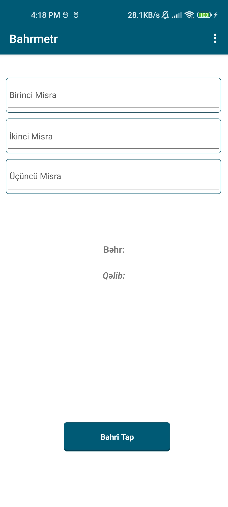
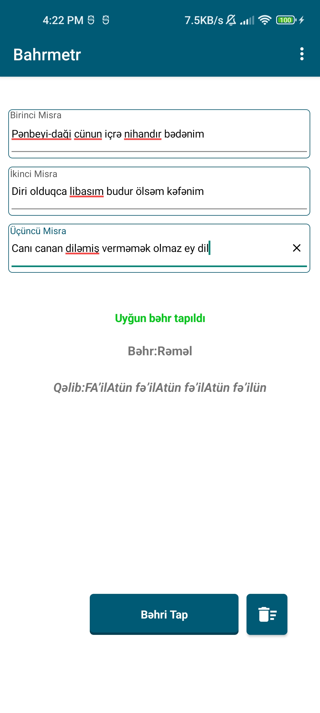
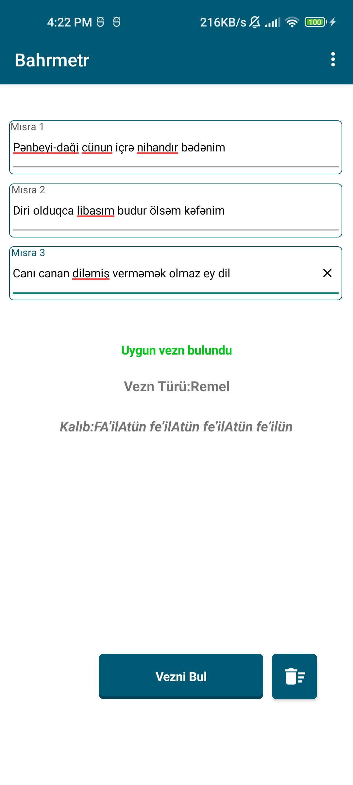
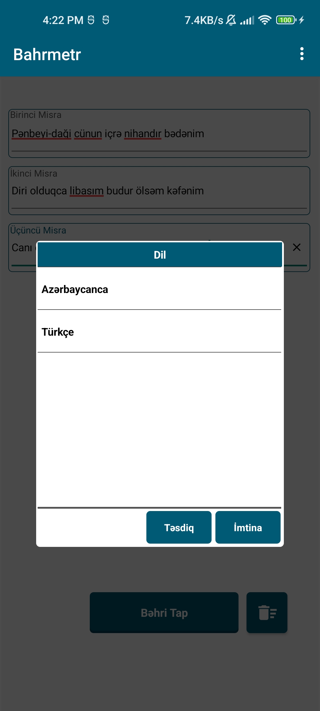

<p align="center">
  
</p>

<h1 align="center">Bahrmetr</h1>

<p align="center">
  Android app that identifies the <strong>aruz prosody meter</strong> of Persian,
  Azerbaijani and Turkish poetry — بهر <span dir="ltr">(behr)</span> and
  <span dir="ltr">قالب</span> <span dir="ltr">(qəlib)</span>.
</p>

<p align="center">
  
  
  
  
</p>

---

Paste three verses of a poem; the app encodes each one into a vowel/consonant
pattern and matches it against a database of 12 aruz meters, returning both the
meter name (*behr*) and its rhythmic pattern (*qəlib*).

| | |
|---|---|
| **Meters covered** | 12 (*behr*) — hazaj, ramal, muzare, khafif, rajaz, sari, mujtass, munsarih, mutadarik, mutaqarib, Kamil, muqtab |
| **Patterns in DB** | 94 canonical patterns + 3,467 encoded verse patterns |
| **Languages** | Azerbaijani · Turkish · English |
| **Network** | None — fully offline |
| **Package id** | `com.coriolis.bahrmetr` |
| **Last release** | 1.0.2 (versionCode 4) |
| **Last modified** | 3 September 2023 |
| **License** | GPL-3.0 |

---

## Screenshots

| | |
|---|---|
|  |  |
| Enter three verses | Match found — Azerbaijani |
|  |  |
| Match found — Turkish | Language selection |

---

## ⚠️ Status: legacy, released as-is

This is the **original source of a shipped Android app**, published for
reference and reuse. It has **not** been modernised and is **not maintained**.

Specifically:

- ❌ It has **not** been rebuilt or re-verified since September 2023.
- ❌ It **does not compile as-is** — see [BUILD.md](BUILD.md) for what is missing.
- ❌ Known **correctness bugs** remain in the matching logic and are documented
  rather than fixed — see [KNOWN_ISSUES.md](KNOWN_ISSUES.md). Read that file
  before trusting any result this app produces.
- ✅ The **data** is readable and usable — see [DATA.md](DATA.md).

### What was changed before publishing

The matching logic and database contents are untouched. Four things were removed
so that the repository presents the app as it would ideally have been:

| Removed | Why |
|---|---|
| **SQLCipher encryption** | The database was encrypted with a password hard-coded in the source, so it never protected anything. It is now plain SQLite. |
| **The database password** | No longer exists anywhere in the project. |
| **Google AdMob** | Ads were unrelated to the app's purpose. |
| **Firebase Analytics + Cloud Messaging** | Supplied by the same library as AdMob and never used. Neither was. |

With those gone the app has **no network code, no tracking, no permissions
beyond the Android defaults, and no secrets**. See [SECURITY.md](SECURITY.md)
for the full record.

---

## How it works

The matching pipeline is a two-stage lookup against a local database.

**Stage 1 — encode (`kodla`)**

Each verse is stripped of punctuation and spaces (`Utils.formatMisra`), then
every character is reduced to a bit:

- `1` if the character is a vowel — `a e i o u ə ö ü ı`
- `0` otherwise

The count of `1`s is the verse's syllable estimate (`hecalar`).

**Stage 2a — canonical pattern match (`qelibTap`)**

A secondary pattern is derived per verse, marking syllable *starts* rather than
vowels: a `1` when a vowel begins a cluster of 2–3 consecutive vowels.
Each verse's syllable count selects a candidate set from `qelibs`, and
candidates within the three verses are scored by ≥75% character agreement.

**Stage 2b — encoded pattern fallback (`checkSimilarity`)**

If no canonical pattern matches, the app falls back to `bahrs`, which stores
every verse pattern it knows. Candidates are scored by longest common prefix and
by overall agreement (≥50% prefix, or ≥85% of total length).

**Stage 3 — pick (`Utils.axtar`)**

A majority vote across the candidates from all three verses returns the winner.

The app then labels the outcome as either a *precise* match or a *probable* one.

---

## Repository layout

```
.
├── README.md            ← you are here
├── KNOWN_ISSUES.md      ← read before trusting any result
├── BUILD.md             ← what it takes to compile this today
├── DATA.md              ← database schema, contents, how to extend it
├── CONTRIBUTING.md
├── SECURITY.md
├── LICENSE              ← GPL-3.0
├── data/
│   └── schema.sql       ← database schema, for convenience
├── docs/                ← icon + screenshots
└── Project/Bahrmetr/    ← the B4X project
    ├── B4XMainPage.bas  ← all application logic (504 lines)
    ├── B4A/             ← the Android target (this is the real app)
    ├── B4J/             ← stub, never built, cannot compile
    └── B4i/             ← stub, never built, cannot compile
```

### Source modules

| Module | Lines | Role |
|---|---:|---|
| `B4XMainPage.bas` | 504 | Encoding, matching, UI, language switching — everything |
| `B4XMainPage.bas` → `aboyt.bas` | 55 | "About" page |
| `B4XMainPage.bas` → `ConnectDB.bas` | 26 | SQLite connection |
| `B4XMainPage.bas` → `Utils.bas` | 193 | Encoding helpers, meter-name translation |
| `B4XMainPage.bas` → `Starter.bas` | 40 | Boot service |
| `B4XMainPage.bas` → `DBUtils.bas` | 413 | Stock B4X utility library (one function used) |
| `B4XMainPage.bas` → `Localizator.bas` | 163 | **Not compiled** — DB-backed i18n (unused) |
| `B4XMainPage.bas` → `ConnectionDB.bas` | 30 | **Not compiled** — superseded by `ConnectDB.bas` |

Two further modules — `Localizator.bas` and `ConnectionDB.bas` — are present
but not part of the build. See
[KNOWN_ISSUES.md](KNOWN_ISSUES.md#dead-code).

---

## Building

You need **Windows** and a licensed copy of **B4X IDE** — B4X is a Windows-only
toolchain and this project references Robocopy in its build steps.

Full instructions, plus the exact library versions this project was last built
against, are in **[BUILD.md](BUILD.md)**.

Short version:

1. Install [B4X IDE](https://www.b4x.com/b4a.html) (version 12.5 or later).
2. Open `Project/Bahrmetr/B4A/Bahrmetr.b4a`.
3. Let the IDE download the 5 B4X libraries listed in the project file.
4. Provide your own signing keystore — **no keystore is committed, by design**.
5. Build.

There is no Firebase project to create, no API key to supply, and no database
password to configure.

---

## The database

`Project/Bahrmetr/B4A/Files/behrdat.db` is the app's only data source. It is a
**plain SQLite file** — open it with any standard tool:

```bash
sqlite3 Project/Bahrmetr/B4A/Files/behrdat.db
```

Schema, contents and instructions for adding meters are in **[DATA.md](DATA.md)**.

---

## Known issues

There are real, confirmed bugs in this code — including one that causes the app
to report a match as "precise" when it is not. They are documented, not fixed.

👉 **[KNOWN_ISSUES.md](KNOWN_ISSUES.md)**

---

## Credits

- **Meter data** was compiled from Şirvani Ədili, *Əruz Vəzninin Sadələşdirilmiş
  Qəlibləri*. The app's own "About" screen credits this book.
- Built with [B4X](https://www.b4x.com/) by [Erel](https://www.b4x.com/b4x.html).
- Published by Elshad Guliyev / Coriolis.

---

## Contributing

Bug reports, algorithm corrections and dataset additions are all welcome — see
**[CONTRIBUTING.md](CONTRIBUTING.md)**. Since this is an unmaintained legacy
release, expect to do your own environment setup.

---

## License

GPL-3.0. Full text in [LICENSE](LICENSE).

The bundled B4X libraries are **not** covered by this license — see
[BUILD.md](BUILD.md#library-licensing).
